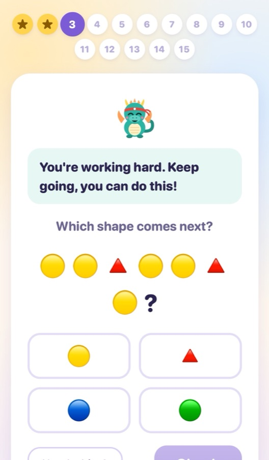
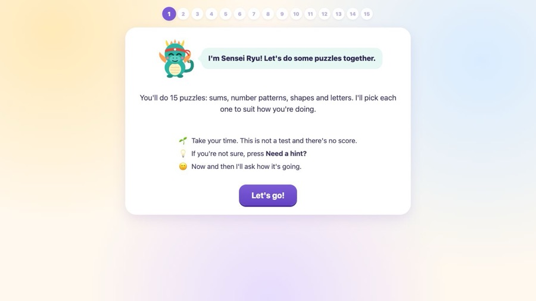

# SensAI

SensAI is my BSc Software Engineering capstone at African Leadership University. It is a web app for learners aged 8 to 14 that notices how a child is working through maths and pattern puzzles, and responds with the right kind of help.

After every answer it runs a two-stage loop:

1. **Stage 1 (state classifier):** reads the learner's recent telemetry (errors and response time over the last five answers) and estimates a behavioural state: *on task*, *rushing* (under-challenged) or *struggling* (needs support).
2. **Stage 2 (scaffolding policy):** a Deep Q-Network trained in simulation picks one of eight actions (easier, harder, different type, hint, encouragement, challenge, simplified repeat, move on). Guardrails rule out actions no teacher would choose.
3. **Adaptation:** the app applies the action. It picks the next question and shows the learner a short message from Sena the owl, or a hint straight away.

States describe what a learner is **observably doing**, not how they feel. SensAI does not claim to detect emotions.

- **Walkthrough video:** _link to be added_
- **Technical report (PDF):** [docs/report/SensAI_Technical_Report.pdf](docs/report/SensAI_Technical_Report.pdf)
- **Repository:** https://github.com/S1rDavid9/SensAI_capstone

<p align="center">
  
  &nbsp;
  
</p>

## What is in this repository

| Part | What it does | Status |
|---|---|---|
| **Simulation and Stage 2** (`environment/`, `training/`) | `AdaptLearn-v1` Gymnasium environment; DQN, PPO, A2C and REINFORCE trained and compared (12 configurations each). Simulator v2 closes two reward loopholes found in the pilot. | Done |
| **Pilot app** (`pilot/`, shadow mode) | Learner, observer and researcher screens used with 31 learners at Excella School, Kigali, on 21 October 2026. The DQN ran in shadow mode: its decisions were stored and **never shown to or used for learners**. | Done, data collected |
| **Stage 1 classifier** (`analysis/`, `models/stage1/`) | Trained on the learners' own check-ins, evaluated by leaving each learner out. | Done |
| **Final MVP** (`pilot/`, adaptive mode) | The closed loop: Stage 1 → shielded DQN → next question and support. | Done; demonstrated by the researcher, not used with children (see Ethics) |
| **Testing** (`tests/`, `docs/testing/`) | Unit, integration, stress and cross-browser tests. | Done |

## Results at a glance

| | Result |
|---|---|
| Pilot | 31 learners started, 30 completed all 15 questions; 463 answers, 94 check-ins |
| Stage 1 (leave-one-learner-out) | Balanced accuracy **0.67** (chance 0.33); detects "needs support" with AUC **0.90**. Error rate carries almost all of the signal. |
| Stage 2 on the real pilot data | Under-challenged → move on / challenge; needs support → simplified repeat, easier, encourage. On-task is the weak spot (the DQN wants to make it easier; the guardrail blocks it in 94 cases). |
| Simulator v2 | The DQN no longer moves on when the learner is confused (69% → 0%); PPO, A2C and REINFORCE collapse to one or two actions, so DQN is the policy carried forward. |

Full analysis: `analysis/results/stage1.json`, `analysis/results/stage2_pilot.json`, `logs/v2/evaluation.md`.

## Technical requirements

| | Version used |
|---|---|
| macOS (tested), Linux, or Windows with WSL | macOS 26 on Apple M1, 8 GB RAM |
| Python | 3.11 (3.11 or 3.12 supported) |
| [uv](https://docs.astral.sh/uv/) | Python package manager |
| Node.js | 20 or later (built with 25.5) |
| Backend | FastAPI 0.141, Uvicorn 0.52, Pydantic 2.13, SQLite |
| Machine learning | PyTorch 2.13, Stable-Baselines3 2.9, Gymnasium 1.3, scikit-learn 1.9, XGBoost 3.2, NumPy 2.4, pandas 3.0 |
| Frontend | React 19, React Router 7, TypeScript 5.9, Vite 7 |
| Testing | pytest 9, Playwright 1.64 (Chrome, WebKit, Firefox) |
| Learner devices | Any modern browser. Tested on Chromebooks, iPhone, iPad, Android, Mac and Windows laptops. |

XGBoost on macOS also needs OpenMP: `brew install libomp`.

## Installation

```bash
git clone https://github.com/S1rDavid9/SensAI_capstone.git
cd SensAI_capstone
uv sync --extra dev --extra analysis
cd pilot/web && npm install && npm run build && cd ../..
uv run pytest
```

## Running the app

Start the server from the repository root:

```bash
PILOT_RESEARCHER_KEY=choose-a-key PILOT_OBSERVER_KEY=teacher-key uv run uvicorn pilot.server:app --host 0.0.0.0 --port 8001
```

| Screen | Address | For |
|---|---|---|
| Researcher | http://localhost:8001/researcher | Create a session (only after recording guardian consent and learner assent), choose **Pilot** or **Adaptive** mode, follow answers and decisions live, export CSVs |
| Learner | http://localhost:8001/learn | The child's screen: enter the code (P01, P02, …) and do the puzzles |
| Observer | http://localhost:8001/observe | Researcher's or teacher's phone: every 20 seconds, code what one learner is doing |

Other devices on the same Wi-Fi use the laptop's address instead of `localhost` (`ipconfig getifaddr en0` on a Mac). Without the environment variables the keys are `sensai-dev` and `sensai-observe`, for local testing only. Set `PILOT_DB=pilot/data/demo.sqlite3` to practise without touching real data.

To try the closed loop: create a session in **Adaptive** mode, then answer quickly and correctly (SensAI moves on and adds challenges) or keep getting answers wrong (it eases off, simplifies and encourages). The researcher screen shows every decision, including where a guardrail changed the DQN's choice.

## Testing

```bash
uv run pytest                                          # 77 unit and integration tests
uv run pytest --cov=pilot                              # coverage (app code: 96%)
uv run python -m tests.performance.load_test           # stress test: 10-100 learners at once
uv run python -m tests.compatibility.browser_matrix    # full sessions in Chrome, WebKit and Firefox
```

| Approach | Result | Improvements made from it |
|---|---|---|
| Unit and integration (pytest) | 77 tests, 96% of `pilot/` covered; includes a test that shadow-mode decisions never reach the learner | |
| Stress (`docs/testing/load_test_results.md`) | 0 failed requests out of 32,000 at 10-100 simultaneous learners, both modes; at 30 learners with no thinking time, 95% of requests under 0.45 s | Fixed "database is locked" when several workers start; loaded the Stage 1 model at startup (removed a 2 s delay); SQLite WAL mode |
| Compatibility (`docs/testing/compatibility_results.md`) | 7/7 browser and device targets pass full sessions; no JavaScript errors, no horizontal overflow | Raised learner buttons from 43 px to at least 48 px |
| Field test (the pilot) | 31 learners on Chromebooks, phones, iPads and laptops in Chrome, in batches of about 12 | Device and browser are now recorded with each session |

## Repository structure

```
pilot/                  The app (backend in layers, frontend in web/)
  core/                 Behavioural states, telemetry, the 40-question bank
  labelling/            StateLabeler interface: RuleBasedLabeler (pilot), Stage1Labeler (trained)
  policy/               DQNPolicy and the Shield that applies guardrail rules
  adaptation/           CurriculumPlanner: action -> next question and support message
  storage/              Database (with safe upgrades) and one repository per table
  services/             Learning, session and observation use cases; ShadowMode and AdaptiveMode
  api/                  Schemas, access keys, routes, create_app()
  web/                  React + TypeScript screens (learner, observer, researcher)
  data/                 Pilot database (git-ignored: never committed)
environment/            AdaptLearn-v1 simulator (v1 and v2 rules)
training/               DQN and policy-gradient sweeps, comparison plots
analysis/               Pilot analysis: dataset building, Stage 1 training, Stage 1 -> DQN replay
models/                 Trained policies (v1, v2) and the Stage 1 classifier
logs/                   Training logs and evaluations (v1 in logs/dqn, logs/pg; v2 in logs/v2)
tests/                  Unit and integration tests; performance/ and compatibility/ suites
docs/testing/           Stress, compatibility and coverage results, screenshots
ModelNotebook.ipynb     Stage 2 model notebook (MVP milestone)
api/, main.py           Earlier milestone: JSON API demo and command-line entry point for training
```

## Ethics and data

The pilot was approved by the ALU Research Ethics Committee. Only learners with signed guardian consent who also gave their own assent are included in the data. No names are entered into the system: learners are known only by a participant code, and the paper list linking codes to names is kept separately and destroyed two weeks after the last session. The pilot database is git-ignored; it is kept on the researcher's laptop and private ALU Google Drive, accessible only to the researcher and supervisor.

During the pilot the DQN ran in **shadow mode**: every learner saw the same 15 questions, and the model's decisions were stored but never shown to learners or used to change what they saw. Adaptive mode has been demonstrated by the researcher only; using it with children would need a new ethics approval.

## Deployment

The app runs on the researcher's laptop and serves learners over the school's Wi-Fi (a phone hotspot or travel router is the fallback). No cloud service receives learner data. For wider use, the same server can run on a host with persistent storage (Render, Railway or Fly.io; Vercel's serverless functions cannot keep the SQLite file), with the database moved to PostgreSQL and each school given its own keys.

## Known limitations

- Pilot sample: 31 learners at one school, one session each; only 11 check-ins said "hard" or "lost".
- Observations were too sparse to measure agreement between observers (no paired codes), so Stage 1 is trained on self-reports only.
- The DQN still makes weak choices for on-task learners; the guardrails and the plausibility rating (pending) address and measure this.
- REINFORCE results are not reproducible (unseeded environment resets in its training loop).
